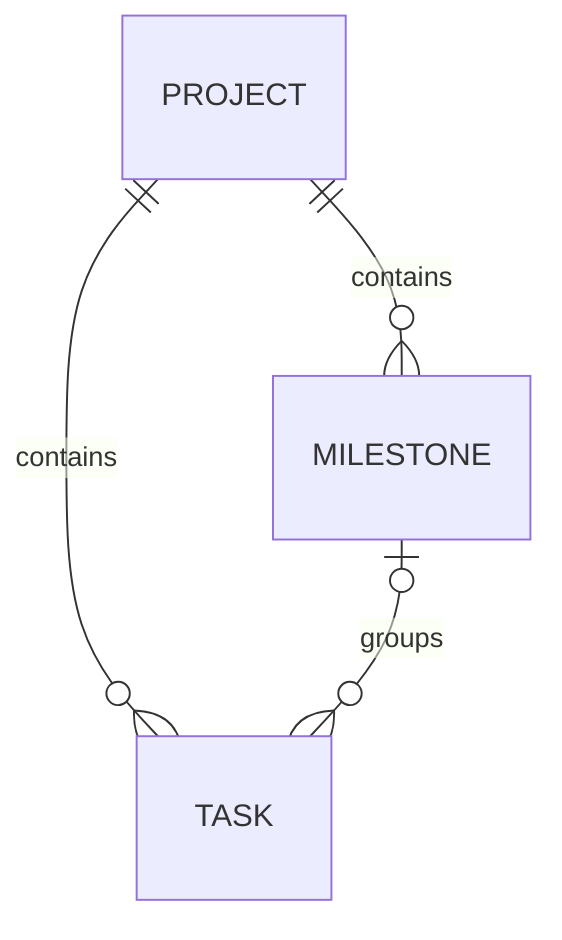

# 프로젝트 마일스톤 설계안

작성일: 2026-10-13 · 상태: 구현 및 기능 검증 완료 · 커밋/배포 전

## 1. 목표와 권장 범위

마일스톤은 **한 프로젝트에서 특정 목표일까지 달성할 결과와 그에 속한 태스크를 묶는 단위**다. 예: “베타 출시”, “결제 기능 오픈”. 프로젝트 간 목표나 반복 스프린트로 확장하지 않는다.

- 프로젝트 하나에 마일스톤 여러 개, 태스크 하나에는 마일스톤 0개 또는 1개.
- 이름, 설명, 목표일, 열림/닫힘 상태와 태스크 진행률을 제공한다.
- 목록/상세, 생성/편집/삭제, 닫기/다시 열기, 태스크 연결/해제, 보드 필터를 첫 버전에 포함한다.
- 하위 태스크도 독립적으로 연결한다. 부모의 마일스톤을 자동 상속하거나 변경을 전파하지 않는다.
- 여러 프로젝트를 묶는 로드맵, 다중 연결, 의존성, 담당자, 가중치, 자동 마감, 알림 스케줄러, 외부 GitHub/Gitea 마일스톤 동기화는 후속 범위다.

## 2. 현재 코드에서 확인한 조건

| 근거 | 설계에 주는 영향 |
|---|---|
| `apps/api/src/database/schema.ts`: project → task, column의 `isFinal`, task의 `status`와 nullable `columnId` | 프로젝트 소속을 보장하고 완료 계산은 워크플로를 따른다. |
| `apps/api/src/task/controllers/get-tasks.ts`: 컬럼별 태스크 및 별도 `planned`/`archived` 버킷 | 보드 필터와 집계의 보관 태스크 정책을 구분한다. |
| `apps/api/src/task/controllers/move-task.ts`: 같은 워크스페이스 내 프로젝트 이동을 트랜잭션으로 처리 | 이동 시 기존 마일스톤 연결을 같은 트랜잭션에서 해제한다. |
| `apps/api/src/project/controllers/get-public-project.ts`: `getTasks()` 결과 재사용 | 내부 응답에 필드를 추가하기 전에 공개 응답을 명시적으로 분리한다. |
| `packages/permissions/src/index.ts`, `require-workspace-permission.ts`: DB에 저장된 편집 가능한 역할, API key scope 검사 | 첫 버전은 기존 project/task 권한을 재사용한다. 역할 이름으로 검사하지 않는다. |
| `apps/api/src/ws/index.ts`, `apps/web/src/hooks/use-project-websocket.ts`: 프로젝트 이벤트와 Query invalidation | 마일스톤 변경 및 진행률 변화도 동일한 전달 경로에 추가한다. |
| `apps/api/src/column/controllers/update-column.ts`: `isFinal` 수정 시 현재 이벤트 발행 없음 | 태스크 수정 없이도 진행률이 바뀌는 경로를 추가로 처리한다. |
| `apps/web/src/components/common/project-layout.tsx`: 데스크톱/모바일 프로젝트 뷰 전환 | 마일스톤 탭과 프로젝트 전환 후 뷰 유지 동작을 함께 확장한다. |

## 3. 사용자 경험

프로젝트 내 `마일스톤` 탭을 추가한다. 기본 화면은 열린 마일스톤 목록이며, 닫힌 항목으로 전환할 수 있다. 목표일 오름차순, 목표일 없는 항목은 마지막, 동률은 생성일과 ID로 안정적으로 정렬한다.

목록 행은 이름, 목표일, `완료 6 / 전체 10`, 진행 막대, 상태를 보여준다. 상세에는 설명과 연결된 태스크 목록, 기존 태스크 연결, 이 마일스톤에 태스크 생성, 편집/닫기/삭제 동작을 둔다. 태스크는 페이지 단위로 조회하고 기존 상세 시트를 재사용한다.

태스크 속성 사이드바에는 `마일스톤` 선택기를 추가한다. 같은 프로젝트의 열린 항목과 `없음`을 선택한다. 이미 닫힌 마일스톤에 속한 태스크는 현재 값을 계속 표시하며 연결 해제 또는 열린 항목으로 변경할 수 있다. 보드/목록에는 선택 가능한 배지와 마일스톤 필터를 제공한다. 대량 연결/해제도 기존 bulk toolbar에 추가한다.

초기 빈 화면에는 설명과 생성 버튼, 검색 결과가 없을 때는 별도 빈 상태를 제공한다. 권한 없는 사용자는 읽기만 가능하며, 저장 실패 시 입력을 유지한다. 선택기는 키보드로 조작 가능하고 진행률을 색상만으로 표현하지 않는다. 사용자 문구는 `i18n/en-US.json`의 정적 키로 정의하고 기존 번역 체계를 따른다.

## 4. 동작 규칙

### 상태와 날짜

- 상태는 `open | closed`. “모든 태스크 완료”와 “목표를 마감함”은 별개다.
- 진행률 100%여도 자동으로 닫지 않는다. 미완료 태스크가 있어도 명시적인 닫기가 가능하며 UI에 미완료 개수를 보여준다.
- 닫기 시 `closedAt`을 설정하고 다시 열면 null로 만든다. 동일 상태로의 재요청은 멱등 처리한다.
- 닫힌 항목에도 기존 태스크 변경은 가능하며 진행률은 현재 데이터를 반영한다. 마감 당시의 스냅샷은 제공하지 않는다.
- 닫힌 항목에 새 연결은 거절한다. 먼저 다시 열어야 한다. 현재 연결을 같은 값으로 저장하는 요청은 성공시킨다.
- 목표일은 선택적인 달력 날짜 `YYYY-MM-DD`다. PostgreSQL `date`와 문자열을 사용하며 UTC timestamp로 변환하지 않는다.
- 지연 표시는 `open && dueDate < 사용자 현지 오늘 날짜`. 목표일 당일은 지연이 아니다. API는 목표일을 반환하고 지연 여부는 UI가 자정 및 창 재활성화 시 갱신한다. 사용자 시간대에 따라 지연 표시가 다를 수 있으며 공유 시간대 설정은 첫 버전에 추가하지 않는다.
- 태스크 마감일과 마일스톤 목표일은 독립적이며 어느 쪽도 다른 날짜를 자동으로 수정하지 않는다.

### 진행률

```text
totalTasks = 연결된 태스크 중 status != archived 인 수
completedTasks = totalTasks 중 해당 프로젝트의 status 컬럼이 isFinal = true 인 수
progressPercent = totalTasks == 0 ? 0 : round(completedTasks / totalTasks * 100)
```

- `planned`는 미완료로 포함한다. `archived`는 분자/분모 모두 제외하고 `archivedTasks` 개수를 별도로 반환한다.
- 현재 보관 방식은 status를 `archived`로 바꾸므로 보관 직전 완료 상태를 복원해서 집계하지 않는다. 완료 태스크를 보관하면 진행률이 내려갈 수 있다. UI에는 “보관한 태스크 제외”를 표시한다.
- 기본 완료 판정은 현재 보드와 맞춰 `(projectId, status → column.slug)`의 `isFinal`이다. `done` 문자열을 하드코딩하거나 nullable `columnId`에만 의존하지 않는다. 매칭되는 컬럼이 없으면 미완료다.
- 부모와 자식 모두 명시적으로 연결했다면 각 태스크를 한 번씩 센다. 하위 관계를 따라 재귀적으로 합산하지 않는다.
- 태스크가 없으면 `태스크 없음`을 표시한다. 페이지 크기나 태스크 필터는 전체 진행률에 영향을 주지 않는다.
- 집계는 서버의 단일 GROUP BY 쿼리로 목록 전체를 계산한다. 마일스톤마다 태스크를 조회하는 N+1, 모든 태스크를 브라우저로 전달하는 집계, 저장된 카운터는 도입하지 않는다.

### 이동과 삭제

- 다른 프로젝트로 태스크 이동 시 `milestoneId = null`. 동명 마일스톤에 자동 연결하지 않는다. 원본과 대상 프로젝트 캐시 모두 갱신한다.
- 마일스톤 삭제는 태스크를 삭제하지 않는다. 연결 해제와 마일스톤 삭제를 한 트랜잭션으로 처리하며 UI에 영향 개수를 표시한다.
- 프로젝트 삭제는 소속 태스크와 마일스톤을 함께 삭제한다. 프로젝트 보관/복원은 마일스톤 상태를 바꾸지 않는다.
- 태스크 삭제는 집계에서 제거하며, 연결 해제는 원래 마일스톤의 집계에 반영한다.

## 5. 데이터 모델과 무결성



| `milestone` 필드 | 형식 / 규칙 |
|---|---|
| id | text PK, 기존 createId 방식 |
| projectId | text NOT NULL, project FK, 프로젝트 삭제 시 CASCADE |
| name | text NOT NULL, trim 후 1–200자, 같은 이름 허용 |
| description | nullable text, 최대 10,000자, 첫 버전은 일반 텍스트 |
| dueDate | nullable date, 유효한 달력 날짜 검증 |
| status | text NOT NULL DEFAULT open, CHECK open/closed |
| closedAt | nullable timestamp, status와 일관성 CHECK |
| createdAt / updatedAt | 기존 DB timestamp 방식 |

`task`에는 nullable `milestoneId`만 추가한다. workspaceId는 project에서 유도하고 마일스톤에 중복 저장하지 않는다. 진행률 역시 저장하지 않는다.

- `milestone(projectId, id)` UNIQUE 및 `task(projectId, milestoneId) → milestone(projectId, id)` 복합 FK로 다른 프로젝트 연결을 DB에서도 차단한다.
- 복합 FK의 삭제 동작은 NO ACTION으로 두고, 컨트롤러가 참조를 먼저 해제한다. 복합 FK 전체에 SET NULL을 적용해 task.projectId까지 비우면 안 된다.
- 인덱스: `milestone(projectId, status, dueDate)`, `task(projectId, milestoneId)`.
- 연결/닫기/삭제의 경합을 막기 위해 같은 마일스톤 행을 트랜잭션 내에서 잠근 후 상태와 소속을 재확인한다. 태스크의 프로젝트 이동과 연결 변경도 태스크 행 잠금 및 일관된 잠금 순서로 직렬화한다. 복합 FK는 최종 방어선이며 경합 오류를 설명 가능한 409로 변환한다.
- bulk 연결은 모든 ID의 존재, 동일 프로젝트, 권한, 열린 대상 여부를 먼저 검증하고 전체 성공 또는 전체 롤백한다. null을 통한 bulk 해제는 기존과 같이 같은 워크스페이스의 여러 프로젝트에서 허용한다.
- `schema.ts`, `relations.ts` 수정 후 `pnpm --filter @kaneo/api db:generate`로 마이그레이션을 생성하고 SQL을 검토한다. 기존 태스크는 null로 유지한다. 기존 데이터 백필이나 역할 변경은 없다.
- 운영 업그레이드에서는 additive migration 후 새 API/web을 배포한다. 구버전 API와 신버전 API의 장기 혼용은 피한다. 구버전 이동 로직은 새 연결을 해제하지 못하므로 이동 시 복합 FK에 막힐 수 있다.

## 6. API와 권한

새 모듈 `apps/api/src/milestone/{index,schema,response}.ts`와 `controllers/`를 만들고 기존 `apiRouter()` / `createRoute()` 패턴으로 `/api/milestone`에 등록한다. 아래 경로는 제안하는 전체 API 경로다.

| 메서드 / 경로 | 용도 | 요구 권한 |
|---|---|---|
| GET `/api/milestone/project/{projectId}` | 목록과 전체 집계, status/page/limit | project.read + task.read |
| POST `/api/milestone/project/{projectId}` | 생성 | workspace owner/admin 역할 + project.update |
| GET `/api/milestone/{id}` | 상세와 집계 | project.read + task.read |
| PATCH `/api/milestone/{id}` | 메타데이터 수정, 닫기/다시 열기 | project.update |
| DELETE `/api/milestone/{id}` | 연결 해제 후 삭제 | project.update + task.update |
| GET `/api/milestone/{id}/tasks` | 페이지별 연결 태스크, 보관 필터 | project.read + task.read |
| PATCH `/api/task/{id}/milestone` | `{ milestoneId: string \| null }` | task.update + project.read |

생성은 사용자 요청에 따라 workspace owner/admin 역할로 제한하며 project.update도 함께 검사한다. 커스텀 역할에 project.update가 있어도 생성할 수 없다. 기존 마일스톤 편집에는 project.update를 사용하므로 기본 member는 기존 마일스톤에 태스크를 연결할 수 있지만 마일스톤 자체를 만들거나 닫을 수 없다. 기본 admin/owner는 관리할 수 있고 viewer는 읽기만 한다. 생성은 명시적인 역할 검사에 더해 현재 저장된 project.update 권한과 API key scope를 검사한다. 기존 항목 편집은 현재 저장된 권한과 API key scope의 교집합을 따른다. 별도 milestone 권한은 운영상 필요가 확인될 때 도입한다. 새 권한을 추가한다면 기존 DB 역할의 업그레이드 정책까지 별도로 설계해야 한다.

- 모든 경로에서 프로젝트 → 워크스페이스 소속을 서버에서 해결하고 `requireWorkspacePermission`을 적용한다. 요청의 workspaceId를 신뢰하지 않는다.
- 마일스톤 상세 경로는 `workspaceAccess.fromMilestone`에 해당하는 resolver를 추가한다. `createRoute({ middleware })`는 validator보다 먼저 실행되므로 raw param/body를 사용한다.
- ID 존재 여부를 권한 없는 워크스페이스에 누출하지 않도록 기존 접근 제어 오류 정책을 따른다. 400 입력/소속 불일치, 401 인증 없음, 403 권한 부족, 404 접근 가능한 범위 내 대상 없음, 409 닫힌 대상/경합을 OpenAPI에 명시한다.
- 응답은 명명된 `Milestone`, `MilestoneWithStatistics`, `MilestoneListResponse` 스키마를 정의한다. 집계는 totalTasks, completedTasks, archivedTasks, progressPercent를 반환한다.
- create-task에 optional nullable milestoneId를 추가한다. 생략은 기존 동작, null은 연결 없음이다. 기존 전체 update-task는 연결을 그대로 유지하고, 변경은 전용 PATCH로 수행한다.
- 기존 `/api/task/tasks/{projectId}`에는 `milestoneId` 또는 `withoutMilestone=true` 필터를 추가하고 둘을 동시에 지정하면 400으로 거절한다.
- 기존 bulk API에 `updateMilestone` operation을 추가하고 `value`의 ID/null 계약과 권한 검사를 확장한다.
- 인증된 task/board/my-tasks 응답에는 필요한 milestoneId를 명시적으로 포함한다. 이름은 프로젝트 마일스톤 조회 캐시와 결합하며 권한 검사 없이 상세 정보를 자동 확장하지 않는다.
- 공개 프로젝트에는 첫 버전에서 마일스톤 ID/이름/설명/날짜/통계를 노출하지 않는다. 공개 전용 스키마와 응답 projection을 만들고 `c.json()`이 자동으로 내부 필드를 제거할 것이라고 가정하지 않는다. 공개 activity 응답이 존재한다면 이벤트 데이터도 같은 기준으로 제한한다.

## 7. 이벤트, 활동 기록, 캐시

DB commit 후 `milestone.created`, `milestone.updated`, `milestone.deleted`, `task.milestone_changed`를 발행한다. 닫기/열기는 updated의 상태 변경으로 표현한다. 태스크 연결 이벤트에는 taskId, projectId, actor, old/new milestone ID 및 이름 스냅샷을 넣어 이름 변경/삭제 후에도 태스크 활동 기록을 읽을 수 있게 한다. 활동 문구는 화면에서 i18n 키로 렌더링한다.

마일스톤 자체의 별도 활동 피드는 첫 버전에서 만들지 않는다. 태스크 생성 시 최초 연결, 기존 연결 변경/해제, 이동에 따른 해제, 마일스톤 삭제에 따른 해제는 기존 태스크 활동 경로에 남긴다. 현재 이벤트 버스는 내구성 있는 작업 큐가 아니므로 활동 기록의 보장 수준은 기존 기능과 같으며 exactly-once를 약속하지 않는다.

실시간 메시지는 전체 프로젝트 캐시를 다시 검증하는 `MILESTONES_UPDATED`를 사용한다. 프로젝트 ID와 메시지 타입만 보내므로 현재 broadcast coalescing과 Redis schema에 불필요한 새 payload 필드를 넣지 않는다. 태스크 연결 변경은 기존 `TASK_UPDATED` 경로도 통과시킨다.

| 원인 | 재검증 대상 |
|---|---|
| 마일스톤 생성/편집/닫기/열기 | 해당 프로젝트의 목록/상세 |
| 연결/해제 및 bulk 변경 | 목록/상세/마일스톤 태스크, 해당 task, tasks, my-tasks, activities |
| 태스크 생성/삭제/상태 변경/보관/복원 | 마일스톤 집계와 태스크 목록, 기존 태스크 캐시 |
| 태스크 이동 | 원본/대상 프로젝트의 목록/상세/태스크 캐시 |
| 컬럼 isFinal 변경 및 워크플로 변경 | 프로젝트 정의, 태스크 표시, 마일스톤 집계 |
| 마일스톤 삭제 | 목록, 해당 상세 캐시 제거, task/tasks/my-tasks 및 열린 활동 화면 |

Query key는 `['milestones', projectId, filters]`, `['milestone', projectId, id]`, `['milestone-tasks', projectId, id, filters]`를 사용한다. `@kaneo/libs` client → fetcher → query/mutation hook 경로를 유지한다. 첫 버전은 서버 집계 재조회 방식으로 구현하고 카운터를 낙관적으로 증감하지 않는다.

요청을 보낸 창은 broadcast에서 제외될 수 있으므로 mutation 성공 시에도 같은 invalidation helper를 호출한다. 다른 창은 WebSocket 이벤트로 갱신한다. 기존 태스크 상태 이벤트에도 마일스톤 query invalidation을 추가하고 컬럼 설정 변경에는 새 이벤트 경로를 연결한다. 마일스톤 삭제처럼 다수 태스크에 영향이 있으면 project 범위로 무효화해 모든 ID를 WebSocket에 싣지 않는다.

연결 복구 시 해당 프로젝트의 활성 query를 재검증하고, WS 없는 상황에서도 기존 태스크 조회와 맞춘 30초 polling 및 창 focus refetch로 수렴시킨다. in-memory/Redis adapter를 모두 사용하며 Redis는 선택 사항으로 유지한다.

## 8. 연계 범위

- API key는 기존 권한 검사 경로를 그대로 적용한다. 별도 인증 방식을 만들지 않는다.
- `apps/api/src/mcp`와 `packages/mcp` 양쪽에서 목록/상세/생성/수정/삭제/태스크 연결 도구 및 스키마를 맞춘다. 기존 도구 이름/인수는 유지하고 추가 인수는 optional로 한다. API 경유 또는 동일 도메인 함수의 권한 검사를 반드시 적용한다.
- generic webhook 등의 구독 목록/스키마가 새 내부 이벤트를 자동 노출하지 않는지 확인한다. 첫 버전에는 외부 전용 마일스톤 이벤트를 추가하지 않는다.
- 기존 task export/import 형식은 유지한다. 마일스톤과 연결 정보는 해당 내보내기로 이관되지 않는다는 제한을 문서화한다. 완전한 프로젝트 이관용 마일스톤 직렬화는 후속 작업이다.
- Gantt/캘린더의 마일스톤 표시, 워크스페이스 전체 로드맵, 마감 알림은 후속으로 분리한다. 첫 버전의 완료 조건에 포함하지 않는다.

## 9. 구현 순서와 검증 기준

1. **데이터와 도메인:** schema/relations/migration, 진행률 집계, CRUD와 연결 트랜잭션, 권한과 API/OpenAPI. 기존 설치 데이터로 migration 및 프로젝트 cascade 삭제를 검증한다.
2. **태스크 연계와 보호:** 생성/전용 연결 PATCH/bulk/이동/삭제 경로, 공개 응답 projection, 태스크 활동 및 이벤트. 다른 프로젝트/워크스페이스 연결과 권한 우회를 통합 테스트로 차단한다.
3. **웹 화면과 실시간:** 프로젝트 탭, 목록/상세, 선택기와 필터, 모바일 전환, i18n, query/mutation 및 WebSocket. 두 브라우저 창과 Redis 사용/미사용에서 동일하게 갱신되는지 확인한다.
4. **클라이언트 계약:** HTTP/stdio MCP 도구, API 문서 및 내보내기 제한, 관련 패키지 typecheck, 사용자 흐름 브라우저 검증.

필수 시나리오:

- 기존 태스크가 마이그레이션 후 그대로 보이고 milestoneId가 null이다.
- viewer는 읽기만, 기본 member는 연결/해제만, 관리자와 편집된 커스텀 역할은 실제 권한에 맞게 동작한다. 제한된 API key도 같은 규칙을 따른다.
- 태스크 이동/삭제, 마일스톤 삭제, 연결/해제, 닫기/다시 열기 모두 원래 상태로 돌아가는 동작이 명확하다.
- 연결/닫기/삭제/이동의 동시 요청에도 프로젝트 불일치나 닫힌 대상 신규 연결이 생기지 않는다. bulk 일부 실패 시 전체 롤백한다.
- 0개, 전부 완료, planned/archived, 사용자 정의 완료 컬럼, isFinal 변경, 부모/자식 동시 연결에서 정의한 집계가 나온다.
- 상세 페이지네이션/필터와 전체 집계가 독립적이며, 대규모 목록이 N+1 쿼리를 만들지 않는다.
- 변경한 창, 다른 창, 재연결한 창에서 집계와 태스크 배지가 수렴하고 삭제한 상세는 적절한 없음 상태가 된다.
- 공개 프로젝트 JSON에 새 마일스톤 필드가 없고 OpenAPI와 실제 인증 응답이 일치한다.
- 날짜가 시간대 변환으로 하루 밀리지 않고 목표일 당일/다음 날 경계가 정의대로 동작한다.

구현 시 검증은 focused API/unit tests, PostgreSQL integration tests, 관련 web tests, API/web/libs/MCP typecheck, i18n check와 브라우저 패스로 구성한다. 구현과 검증을 완료했으며 결과는 아래와 같다.

### 구현 결과 및 최종 검증 기록

- DB 모델과 additive migration `0045_wide_frank_castle.sql`, API/OpenAPI, 태스크 생성·연결·해제·bulk·이동·삭제, 공개 응답 projection, 활동 기록을 구현했다.
- 생성은 workspace owner/admin 역할에만 허용하며 project.update와 API key scope도 검사한다. project.update가 있는 커스텀 역할이나 member 역할의 instance admin은 생성할 수 없다.
- 마일스톤 목록/상세 및 관리 화면, 태스크 선택기, 보드 배지, 모바일 메뉴를 구현했다. 날짜 선택은 공통 Calendar 팝오버로 통일했고 월 제목과 월 선택 항목은 앱 언어를 따른다.
- 보드·백로그·계층·간트·캘린더·통계에서 마일스톤을 선택할 수 있다. 프로젝트별 공통 상태를 브라우저에 저장하므로 뷰 전환과 새로고침 후에도 유지된다. 기존 보드의 저장된 선택을 이관하며 전체·미지정·닫힌 마일스톤도 지원한다.
- 백로그의 예정·보관 태스크를 필터링하고, 간트의 날짜 범위는 선택된 태스크를 기준으로 계산한다. 통계 API는 현재 마일스톤 연결에 따라 태스크 수·완료율·지연 목록·멤버/팀 월별 차트를 집계한다.
- WebSocket 및 캐시 경로, HTTP/stdio MCP, 한국어/영어 UI 문구와 다른 로케일의 영어 기본 문구, 사용자 문서를 추가했다. Redis adapter는 모의 pub/sub로 검증했으며 실제 Redis 서버는 사용하지 않았다.
- 잠금 파일 기준 pnpm 10.32.1로 의존성을 설치하고 전체 검증을 수행했다. 초기 검증의 Sentry 및 jest-dom 타입 오류는 올바른 의존성 설치 후 해소됐다.
- 전체 단위/UI 테스트 741개 통과: API 394, web 230, MCP 34, planka-import 54, permissions 10, email 16, libs 3. Node 26의 실험적 전역 storage와 jsdom의 충돌을 피하려고 테스트 실행에 `NODE_OPTIONS=--no-experimental-webstorage`를 사용했다.
- 전체 PostgreSQL API 통합 테스트 37개 파일 / 259개 통과. 별도 임시 테스트 DB에서 생성 역할 제한, API key scope, 경합, 복합 FK와 cascade, 마일스톤 통계 및 워크스페이스 격리를 검증했다. 단위/UI와 통합 테스트 합계 1,000개다.
- 전체 워크스페이스 프로덕션 빌드와 타입 검사, 전체 Biome CI 검사, i18n parity 및 diff whitespace 검사가 통과했다. 사이트의 오래된 생성 타입을 현재 소스 기준으로 다시 생성했다. Biome의 기존 경고는 남아 있다.
- 실제 브라우저에서 모바일 메뉴, 소유자의 생성, 목표일 저장, 태스크 생성, 완료 후 진행률 100%, 상세 선택기 및 활동, 닫기/다시 열기, 두 창 간 실시간 갱신을 확인했다. 후속 뷰 필터와 공유 상태는 컴포넌트 테스트로 검증했다.
- 사용자 요청에 따라 로컬 Docker 서버에 기능과 마이그레이션을 적용했다. 로컬 DB는 마이그레이션 전에 백업했으며, 통합 테스트는 실제 로컬 DB를 사용하지 않았다.
